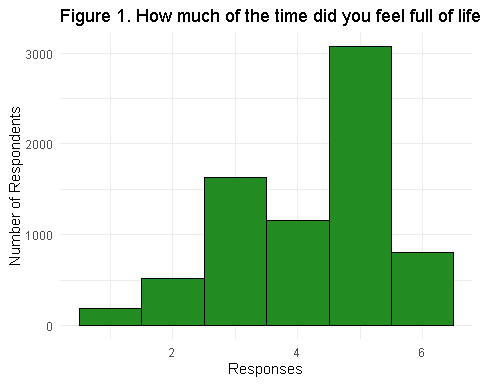
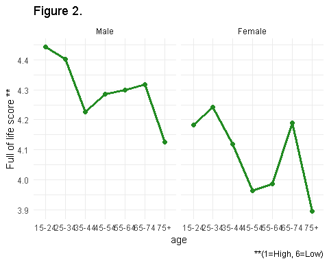
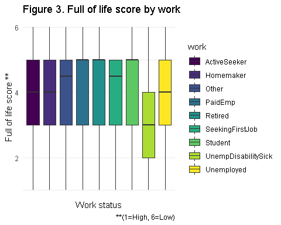
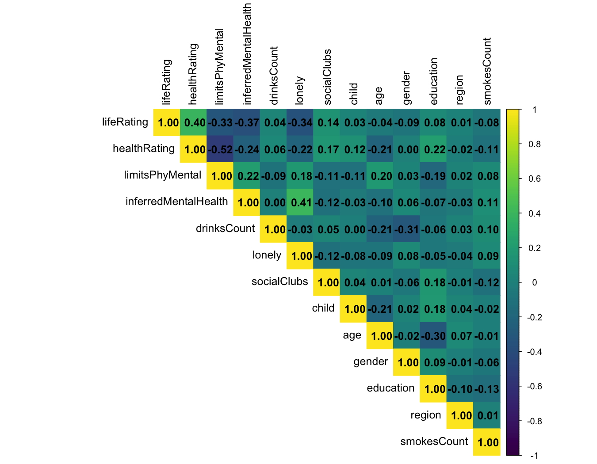
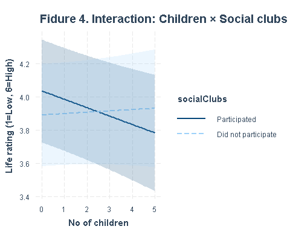
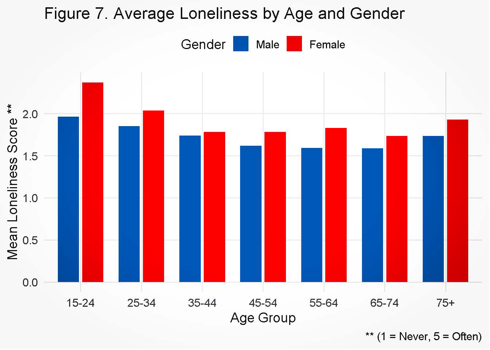
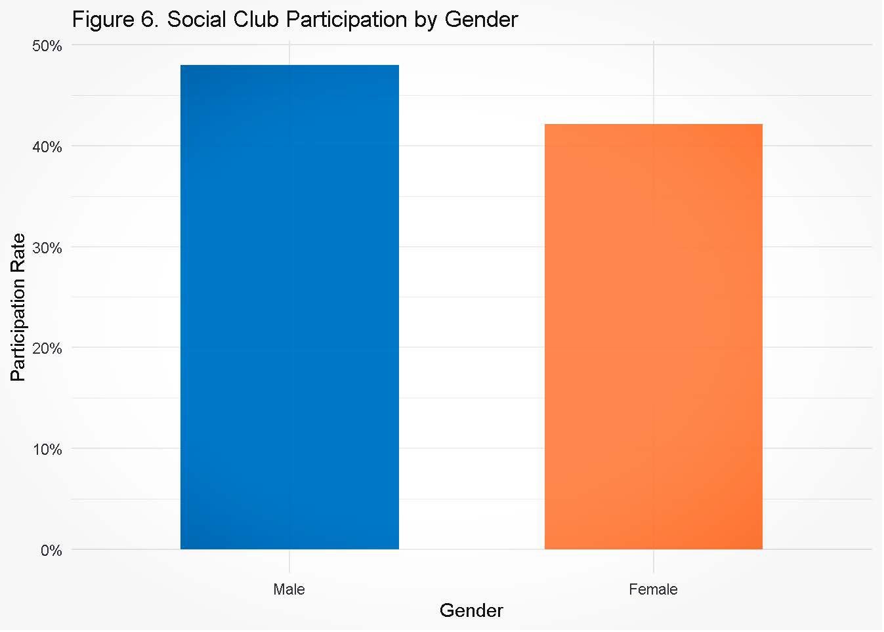

# Data Science Project Econometrics

## 1.0 Introduction

### 1.1 Research Question

This project examines the effects of select health-related factors on individuals’ perception of feeling full of life over the 4 weeks preceding the survey, conducted in 2023. Ireland frequently ranks among the best countries to live according to global indexes. The country ranks in the top 10 globally in terms of quality of life according to the 2022 UN HDI ([United Nations Development Programme, 2022](#ref-undp2022)), with very high scores across many of the sustainable development goals. Ireland also ranks above average in terms of the most recent OECD life satisfaction measures ([OECD, n.d.](#ref-oecd_lifesatisfaction)). From an economic point of view, such rankings are often used to promote Ireland as a prime location for business and establishing growing teams. Feelings of satisfaction and fullness of life potentially have important consequences for productivity also. Research has suggested that there is a relationship between worker satisfaction and happiness, and their productivity ([Bellet et al., 2019](#ref-bellet2019productivity)). In a high skill, high productivity economy such as Ireland, this has clear implications for firms and business leaders. With increased societal focus on mental health, and a record €25.8 billion announced in 2025 for the Department of Health’s budget (Department of Health ([2025](#ref-healthdept2025budget))), it is also timely to examine the topical relationship between perception of health and the degree to which people feel full of life.

Our analysis examines this question on several levels. Measuring how people measure their life satisfaction based on different indicators was an important topic in social science studies. Most studies find that health is a major factor that determines how people perceive their quality of life. Evaluating how people value their health, researchers come up with 2 basic approaches to assess life satisfaction, Bottom Up Approach and Top Down approach. The Top-Down approach assumes that life satisfaction is a personal trait that spreads on other aspects of life, like, for example, subjective health perception. The Bottom Up approach claims that life satisfaction can be disaggregated to various domains ([Diener, 1984](#ref-diener1984)). In our analysis, we will utilize the Bottom Up approach, looking at the respondents life satisfaction rating given their health, demographic and habits domains.

Economic Analysis long ago started to focus on a people’s preferences and even a special branch, called Welfare Economics, evolved from the attempts to evaluate people’s preferences and what makes them better off. Classical measures based on consumption and wealth cannot fully describe Social Well-Being. Information of self-reported life satisfaction and health rating and marginal returns from various factors can help researchers, policymakers and politicians to construct more informed decisions(Krueger et al. ([2009](#ref-krueger2009))).

Firstly, we begin by looking at the relationship that individuals’ personal health has with our primary dependent variable, fullness of life perception. We hypothesize that health plays a large role in determining outlook.

*Hypothesis 1: Feeling full of life is associated with a high perceived general health level.*

Secondly, we investigate the relationship between our main dependent variable and secondary factors. These factors are related to long-term mental and physical illnesses.

*Hypothesis 2: Feeling full of life is negatively associated with long mental or physical illness.*

Finally, we examine the relationships between our dependent and while controlling for a number of demographic factors.

### 1.2 Description of Data

Analysis is based on data from the Healthy Ireland Survey provided by the Central Statistics Office (CSO) with consent from the Department of Health (Department of Health ([2024](#ref-healthyireland2024))). This annual survey details responses from a representative sample size of 7411 respondents across Ireland. Table 1 provides summary statistics for our selected variables. Respondents are on average in a 45-55 age category, equally split between males and females. Respondents have an average education level between NFQ levels 5 and 6, which is equivalent to Leaving Certificate or Higher Certificate. Most participants rated their feeling full of life in the past 4 weeks as “A good bit of the time” or “All of the time” according to survey classification. The result of the survey is consistent with the general findings from other surveys and research around the world, that the majority of respondents tend to report being positive most of the time (Biswas-Diener et al. ([2004](#ref-biswasdiener2004))). Same goes to their perception of health, with a median of 2, most people responded that their health was either Good or Very Good.

| Variable             | N    | Mean | SD   | Min | Median | Max |
|----------------------|------|------|------|-----|--------|-----|
| lifeRating           | 7380 | 4.19 | 1.25 | 1   | 5      | 6   |
| healthRating         | 7380 | 4.17 | 0.79 | 1   | 4      | 5   |
| limitsPhyMental      | 7380 | 1.26 | 0.51 | 1   | 1      | 3   |
| inferredMentalHealth | 7380 | 0.09 | 0.29 | 0   | 0      | 1   |
| cigarettes           | 7380 | 1.12 | 4.26 | 0   | 0      | 60  |
| cigarettesHR         | 7380 | 0.38 | 2.45 | 0   | 0      | 40  |
| pipes                | 7380 | 0.01 | 0.34 | 0   | 0      | 25  |
| cigar                | 7380 | 0.01 | 0.20 | 0   | 0      | 10  |
| drinksCount          | 5984 | 4.39 | 4.00 | 0   | 3      | 40  |
| lonely               | 7380 | 1.78 | 1.11 | 1   | 1      | 5   |
| socialClubs          | 7380 | 0.45 | 0.50 | 0   | 0      | 1   |
| child                | 7380 | 0.60 | 1.03 | 0   | 0      | 5   |
| age                  | 7380 | 3.98 | 1.70 | 1   | 4      | 7   |
| gender               | 7375 | 0.48 | 0.50 | 0   | 0      | 1   |
| workSituation        | 7380 | 2.66 | 2.32 | 1   | 1      | 9   |
| education            | 7348 | 4.57 | 1.92 | 0   | 5      | 8   |
| region               | 7380 | 2.29 | 1.07 | 1   | 2      | 4   |
| smokesCount          | 7380 | 1.50 | 4.89 | 0   | 0      | 60  |

Table 1. Summary of Health Survey

Data is broadly broken down across General Health, Mental Health, GP Use, Smoking &amp; Alcohol, Physical Activity, Nutrition, Sleep, Care and Parental Responsibilities, and Suicide. Response values for questions include binary, continuous and categorical This datDataset consists of different questions concerning perceived health, GP visits, hospital visits, socio-economic questions, alcohol consumption, tobacco consumption, illnesses etc. We distinguished several.







### 1.3 Methodology

Our analysis uses regressions based on Ordinary Least Squares (OLS) estimation. This method is commonly used in social sciences fields for regression analysis and exhibits desirable characteristics including a lack of bias, efficiency, and consistency. Different regressions will have a general form of:

$`Y = \beta X + e`$

where,

Y is a vector of dependent variable values,

X is a matrix of independent variables values,

E is error term vector

Survey answers are reflected in the data by numerical values. We have adjusted the values of Yes/No/Unknown responses, originally recorded as 1,2,3 respectively for the sake of interpreting OLS marginal effects. For such responses, Unknown responses have been removed. Yes/No response values have been reassigned to values of 1 and 0 respectively.

## 2.0 Analysis

### 2.1 Primary Regression

**Variable Selection:**

For the primary selection we will conduct simple regression of life rating, which is evaluation of respondents short-term life satisfaction on health rating to check the magnitude of association between individuals’ subjective evaluation of their own health on how full of life they feel.

Our primary regression model will have a following form:

$\text{lifeRating}_i = \beta_0 + \beta_1 \times \text{healthRating}_i + \epsilon_i$ **life rating**: This variable is based on respondents’ subjective evaluation of feeling full of life. It measures how often respondents felt full of life over the 4 weeks preceding the survey . This consists of 6 categories ranging from “All of the time” to “None of the time”.

**health rating**: This variable is based on respondents’ subjective rating of their own health. It measures general health on a scale from “Very Good” to “Very Bad”, and includes “Don’t know” and “Refused”.

|              |                                      |
|--------------|--------------------------------------|
|              |                                      |
|              | *Dependent variable:*                |
|              |                                      |
|              | lifeRating                           |
|              |                                      |
| Constant     | 1.580\*\**                           |
|              | (0.076)                              |
|              |                                      |
| healthRating | 0.626\*\**                           |
|              | (0.017)                              |
|              |                                      |
|              |                                      |
| Observations | 7,380                                |
| R2           | 0.159                                |
| Adjusted R2  | 0.158                                |
|              |                                      |
| *Note:*      | *p&lt;0.1; **p&lt;0.05;*** p&lt;0.01 |

**Table 2. Primary Regression**

**Multicollinearity &amp; Heteroskedasticity**

The primary regression only contains one independent variable, and so we do not test for the level of multicollinearity as it cannot arise in this instance. The results from the Bresuch-Pagan test with a significantly large test statistic value of 127.66 and a small p-value &lt; 2.2e-16 suggests strong evidence of heteroskedasticity in this regression model. We reject the null hypothesis of constant variance in the error terms Due to the strong evidence of heteroskedasticity we used robust standard errors to interpret this model.

**Interpretation of results**

The primary regression that we consider examines the relationship between how much of the time respondents felt full of life over the past 4 weeks, and these respondents’ subjective rating of their general health. We refer to the dependent variable “feelings of fullness of life” simply as “life rating” for the remainder of this report. We also refer to the variable “respondents’ subjective rating of their general health” as “health rating”.

Our regression produces an estimated beta of 0.626 for health rating, with a standard error of 0.017. This means that our best estimate for the beta is 0.626, and that the true beta is very likely to be in the range of two standard errors between 0.592 and 0.660. The associated for p value for health rating is &lt; 2e-16. This low p-value means that our estimated beta 0.626 is statistically significant and below a significance level of 0.01. There is a less than 1% chance that we would see these results by chance, and so we reject the null that health rating has no effect on life rating. We are over 99% confident that we are not incorrectly rejecting the null.

The estimated beta of 0.626 exhibits a moderately strong correlation between an individuals’ health rating and their life rating. When one’s subjective health rating improves, it is associated with feeling full of life more of the time. This suggests that a better image of one’s health is associated with feeling more full of life.

### 2.2 Secondary Regression

In this secondary regression to better understand the dynamics behind the life rating and health rating we introduce additional health, behavioral, social and lifestyle variables that might reflect the broader determinants of emotional well-being. By expanding the primary model we aimed to capture a more holistic picture of what shapes an individual’s life rating and allows us to test whether part of the relationship between health and life rating still holds and if it might partly work through these additional factors.

**Variable Selection**:

**InferredMentalHealth**: Derived binary variable to indicate probable mental health problem variable (1= Probable mental health problem, 0 = No mental health problem)

**limitsPhyMental**: Captures limitations on everyday tasks due physical and mental health that could negatively affect the perceived well being/full of life survey response. 1 = not limited, 2 = somewhat limited, 3 =severely limited)

**lonely**: A 5 point scale where 1 = never lonely and 5 = often/always lonely. Added as a social and emotional factor, recognizing loneliness could be a significant driver of less energy and full of life feeling;

**smokesCount**: The number cigarettes smoked on average per day, both manufactured and handmade by a daily smoker;

**drinksCount**: The number of standard drinks consumed on average per day by an individual that consumes alcohol on a daily basis;

**socialClubs**: Social group participation, converted the survey responses to a dummy variable. socialClub participation = 1, non-participation = 0.

*Note*: In this model and the subsequent models, Don’t know/refused responses for a few variables were removed to make our analysis cleaner, with the removal resulting in at-most ~ 0.5% data loss. Further we flipped the values to make interpretations more intuitive and variable nomenclature appropriate for the following variables limitsPhyMental, lonely, healthRating, and lifeRating. After the flip for lifeRating deviates from the survey in that \[6 = Feeling full of life all of the time, 1 = None of the time] now, similarly for limitsPhyMental \[1= Not limited, 3=severely limited] and so on.

|                      |                                      |
|----------------------|--------------------------------------|
|                      |                                      |
|                      | *Dependent variable:*                |
|                      |                                      |
|                      | lifeRating                           |
|                      |                                      |
| Constant             | 3.264\*\**                           |
|                      | (0.128)                              |
|                      |                                      |
| healthRating         | 0.387\*\**                           |
|                      | (0.022)                              |
|                      |                                      |
| inferredMentalHealth | -0.888\*\**                          |
|                      | (0.055)                              |
|                      |                                      |
| limitsPhyMental      | -0.261\*\**                          |
|                      | (0.037)                              |
|                      |                                      |
| drinksCount          | 0.004                                |
|                      | (0.004)                              |
|                      |                                      |
| smokesCount          | 0.00004                              |
|                      | (0.003)                              |
|                      |                                      |
| socialClubs          | 0.111\*\**                           |
|                      | (0.028)                              |
|                      |                                      |
| lonely               | -0.202\*\**                          |
|                      | (0.015)                              |
|                      |                                      |
|                      |                                      |
| Observations         | 5,984                                |
| R2                   | 0.271                                |
| Adjusted R2          | 0.270                                |
|                      |                                      |
| *Note:*              | *p&lt;0.1; **p&lt;0.05;*** p&lt;0.01 |

**Table 3. Secondary Regression**

**Interpretation of results**

After expanding the model to account for a broader set of health and behavioral variables, while self-reported health rating remained a significant variable, its coefficient changed from 0.626 to 0.387 suggesting its effect on life rating is partially moderated by the additional health and lifestyle factors. The key influences on life rating were:

1. **inferred mental health problems** - With a statistically significant beta of -0.888 (p &lt; 0.01), there is a strong negative association with life rating, indicating that individuals with inferred mental health problems tend to be associated with lower life rating;
2. **limitations in everyday activities due to health** - A negative statistically significant beta of -0.261 implies being limited in everyday activities due to mental or physical problems is associated with a lower life rating;
3. **participation in social clubs/groups** - A statistically significant beta of 0.111, indicates that participation in social groups is associated with higher lifeRating. Meaning individuals who tend to engage socially feel more full of life. This aligns with expectations, highlighting the value of social connection for overall well-being;
4. **Loneliness indicator** - A statistically significant beta of -0.202, indicates that individuals who feel lonely relatively more often are associated with a lower life rating. Reinforcing the importance of emotional and social connections on overall well-being.

Interestingly, lifestyle variables such as the standard number of drinks had and cigarettes smoked among current daily smokers and alcohol consumers were not statistically significant, meaning we couldn’t associate these habits to life rating with a reasonable confidence level for this particular survey data. The impact of smoking and drinking is hard to assess confidently given that, there could be some cancelling out effect where individuals who consume a limited quantity daily 1-2 smokes or drinks, cancel out the negative effects of substance abusers. Further complications to assessing alcohol consumption and smoking comes from the fact that this is an anonymous survey and substance abusers might be underreporting their consumption.

The adjusted \\(R^2\\) increased from 0.158 to 0.270, suggesting that this model explains a notably large share of variance when accounting for broader health, behavioral and habitual factors. The findings from this regression show that while perceived health is still important in shaping how full of life individuals feel, mental health, physical limitations, loneliness and social participation play a substantial role.

### 2.3 Tertiary Regression

Our third regression builds on the first and second. We introduce several demographic variables in order to examine how these somewhat intrinsic factors relate to life rating. This also allows us to observe any changes in the relationship between life rating and health rating when we hold these demographic variables constant. This allows us to observe the relationships between life rating and other factors without distortion from the additional factors that we control.

**Variable Selection:**

**children**: The number of children that the respondent has;

**gender**:The respondent’s gender; a binary variable;

**region**: The region in which the respondent lives. This is a categorical variable that includes Dublin, Rest of Leinster, Munster, and Connacht/Ulster;

**education**: A categorical variable denoting the highest level of education attained by the respondent;

**age**: The respondent’s age. Ages were recorded in brackets each spanning 9 years from ages 15 to 75+. For example, bracket one ranges from 15 - 24, bracket two ranges from 25-34 years old and so on;

**work**: The respondent’s primary working status, including the reasoning behind lack of employment, retirement, or pursuing education. We hypothesized that this factor would be important to include due to the large amount of time individuals spend at work over the course of their day and life. This was reinforced by the common perception that employment status can affect stress levels, fulfillment and self image. A caveat to our analysis is that we cannot control for income due to the limitations of the data. As a result, the relationship between work status and life rating may be over or understated.

|                         |                                      |
|-------------------------|--------------------------------------|
|                         |                                      |
|                         | *Dependent variable:*                |
|                         |                                      |
|                         | lifeRating                           |
|                         |                                      |
| Constant                | 3.246\*\**                           |
|                         | (0.215)                              |
|                         |                                      |
| healthRating            | 0.394\*\**                           |
|                         | (0.022)                              |
|                         |                                      |
| inferredMentalHealth    | -0.867\*\**                          |
|                         | (0.056)                              |
|                         |                                      |
| limitsPhyMental         | -0.260\*\**                          |
|                         | (0.038)                              |
|                         |                                      |
| drinksCount             | -0.003                               |
|                         | (0.004)                              |
|                         |                                      |
| smokesCount             | -0.001                               |
|                         | (0.003)                              |
|                         |                                      |
| socialClubs             | 0.109\*\**                           |
|                         | (0.028)                              |
|                         |                                      |
| lonely                  | -0.203\*\**                          |
|                         | (0.015)                              |
|                         |                                      |
| child                   | -0.023                               |
|                         | (0.014)                              |
|                         |                                      |
| gender                  | -0.127\*\**                          |
|                         | (0.030)                              |
|                         |                                      |
| education               | -0.015*                              |
|                         | (0.008)                              |
|                         |                                      |
| workHomemaker           | 0.133                                |
|                         | (0.171)                              |
|                         |                                      |
| workOther               | 0.286                                |
|                         | (0.300)                              |
|                         |                                      |
| workPaidEmp             | 0.243                                |
|                         | (0.156)                              |
|                         |                                      |
| workRetired             | 0.366\**                             |
|                         | (0.161)                              |
|                         |                                      |
| workSeekingFirstJob     | 0.102                                |
|                         | (0.513)                              |
|                         |                                      |
| workStudent             | 0.269                                |
|                         | (0.169)                              |
|                         |                                      |
| workUnempDisabilitySick | 0.190                                |
|                         | (0.180)                              |
|                         |                                      |
| workUnemployed          | 0.180                                |
|                         | (0.197)                              |
|                         |                                      |
| region                  | 0.014                                |
|                         | (0.013)                              |
|                         |                                      |
| age                     | -0.033\*\**                          |
|                         | (0.012)                              |
|                         |                                      |
|                         |                                      |
| Observations            | 5,959                                |
| R2                      | 0.277                                |
| Adjusted R2             | 0.274                                |
|                         |                                      |
| *Note:*                 | *p&lt;0.1; **p&lt;0.05;*** p&lt;0.01 |

**Table 4. Tertiary Regression**

**Interpretation of results**

When controlling for demographic factors, the estimated beta for the main independent variable that we examine, health rating, does not change significantly from its estimate in our secondary regression. The estimated beta for health rating is 0.394, with a standard error of 0.021. This means that while our best guess for the beta is 0.394, it could be a standard error above or below this estimate and so range from 0.373 - 0.415. We can say with a high degree of confidence that the true beta will be within two standard errors of our estimate, that is 0.352 - 0.436. The p value is &lt; 2e-16. These values are nearly identical to those for health rating in our secondary regression. This p value is below the 0.05 significance level and so the relationship between health rating and life rating is still statistically significant when controlling for demographic variables on top of those from the secondary regression. The value &lt; 2e-16 is close to 0, and means that we are almost 100% confident that we would not observe such a beta by chance if the real beta was in fact 0. It allows us to confidently reject the null hypothesis that there is no associative effect between these variables.

The tertiary regression indicates that controlling for demographic variables on top of the variables in the secondary regression has little to no effect on the relationship between health rating and life rating. This suggests that the demographic variables are not taking away any significance from health rating’s relationship with life rating, but rather impacting the latter independently (in cases where results are statistically significant). It is possible that there are other demographic variables that we have not accounted for that could result in a different estimated beta for life rating if included.

The key influences on life rating were:

1. **gender** - The responses captured for gender in the data that we examine comprises of male or female. According to our regression, the marginal effect for gender is -0.126, with a standard error of 0.030. Statistically, this effect is significant at the p&lt;0.01 level. The p value of 1.95e-05 means that there is a less than 1% chance that we would see this result by chance, or indeed if we believed that gender had no effect on life rating. This indicates that when controlling for other variables, being female is associated with a very slight reduction in life rating ; c. 0.13 point movement towards a lower response category for life rating. While this is not a considerably large movement in a practical sense, the discrepancy between genders is notable and can be seen in the figure 2.
2. **education** - Data was collected for this variable in a categorical format. The estimated beta for the education variable is -0.015, with a standard error of 0.008. The associated t-value is -1.791 and the p value is 0.0732. The relationship between education and life rating is below a 0.10 significance level threshold and so is statistically significant. This means that we are over 90% confident that we are not incorrectly rejecting the null that this beta is in fact 0. We would see this estimate of beta by chance only about 6% of the time, if we were to believe that the true beta is in fact be 0. The results suggest that an increased level of education is associated with a very slight decrease in life rating. Further examination would be necessary at a more granular level to see precisely what education levels are contributing to this.
3. **age** - The estimated beta for age according to the regression is -0.033, with a standard error of 0.012. The p value is 0.00741, which is lower than a significance level of 0.10, indicating that the relationship between age and life rating is statistically significant. We are over 90% confident that age does not have a beta of 0, meaning that there is very likely a relationship between age and life rating. Our regression suggests that a broad increase in age is associated with a slight decrease in one’s life rating. In a literal sense, if an individual moves from one 9-year age bracket to the subsequent bracket, they should also be about a third of the way to a lower life rating. This relationship is statistically significant, however the results are challenging to interpret due to the categorical nature of data collection.
4. **work** - Data for this variable was collected in a categorical format, with no logical linear relationship between response categories. We converted this variable to a factor in order to balance meaningful, comparable analysis with the limitations of the data. The variable “workRetired” refers to the state of being retired. The estimated beta for this variable is 0.123, with a standard error of 0.049. The p value is 0.0113, which indicates that there is a statistically significant relationship between workRetired and life rating. The recorded p value is below the 0.05 significance level, and very close to a 0.01 level. This means that the probability of mistakenly rejecting the null that there is no association between these variables is less than just over 1%. We are almost 99% confident that there is an association, as it would be highly improbable to see these results if there was in fact no associative effect. Retirement exhibits the most statistically significant relationship with life rating, where there is a mild positive correlation. This indicates that being retired is associated with moving towards a higher life rating from a baseline rating of someone who is working, while controlling for other variables. We estimate that individuals move on average about 12% towards a higher rating, compared with those who are employed.

**Multicollinearity &amp; Heteroskedasticity**

We tested this regression for multicollinearity, and found that most Variance Inflation Factors (VIFs) ranged between 1-1.5. The highest VIFs were for age and work, at 2.20 and 2.93 respectively. These values are below a VIF of 5, which is generally accepted as being the threshold. We can also observe the correlations from Figure 4. Our results indicate that none of these variables are collinear to an extent that would cause problems in terms of coefficient stability nor inadvertently increasing variance.

```
##                          GVIF Df GVIF^(1/(2*Df))
## healthRating         1.478654  1        1.215999
## inferredMentalHealth 1.293350  1        1.137255
## limitsPhyMental      1.473390  1        1.213833
## drinksCount          1.212661  1        1.101209
## smokesCount          1.071542  1        1.035153
## socialClubs          1.094963  1        1.046405
## lonely               1.264753  1        1.124612
## child                1.158897  1        1.076521
## gender               1.186861  1        1.089432
## education            1.292935  1        1.137073
## work                 2.933654  8        1.069579
## region               1.016100  1        1.008018
## age                  2.203133  1        1.484295
```

```
## 
##  studentized Breusch-Pagan test
## 
## data:  tertiaryReg
## BP = 109.65, df = 20, p-value = 2.278e-14
```



Figure 4. Correlation Plot

### 2.4 Interaction Effects

#### 2.4.1 Interaction Effect 1: Social Clubs &amp; Child

We are interested in whether life rating is different for those who have more children, given that they participate in social clubs, and how this affects the estimated beta for health rating.

**Interpretation of results**

While participation in social clubs was associated with higher life rating from the previous results, this effect seems to be moderated by the number of children, with the interaction beta of -0.059 and p-value &lt; 0.01. Specifically, the positive association between social group participation and life rating was stronger for individuals with fewer children. As the number of children an individual has increased, the benefit of social activities on life rating appears to diminish as shown in figure 5. This pattern tracks with conventional logic that growing demands on time, energy and emotional resources that come with raising more children, potentially limiting the ability to participate fully or benefit from social activities.

The estimated beta for health rating is 0.393, with a standard error of 0.021 when we include this interaction effect in the regression, which otherwise has the same variable as our tertiary regression. This estimate for health rating is nearly identical to the tertiary model’s estimate. This is to be expected as the interaction effect is based on variables already included in the tertiary model. Other coefficients also remain very similar between models.



#### 2.4.2 Interaction Effect 2: Drinking &amp; Lonely

We are interested in whether life rating is different for those who are lonely, given that drink, and how this affects the estimated beta for health rating.

**Interpretation of results**

Although a common assumption would be that there is a negative interaction between loneliness and alcohol consumption on life rating, the interaction term between lonely and drinkCount was not statistically significant with a beta -0.003 and robust standard error of 0.003. This suggests that the association between loneliness and subjective life rating does not vary meaningfully across levels of alcohol consumption.

The estimated beta for the interaction effect is -0.003, with a standard error of 0.003. Since the standard error range includes 0, we cannot rule out that there is no relationship between this interaction effect and life rating. When we include this interaction effect, the estimated beta for health rating remains identical to that found in the tertiary model. The control coefficients also stay the same or exhibit minor change. Again, this is not surprising as the interaction effect is based on variables already included in the tertiary model.

### 2.5 Policy Implications

It’s notable that while age is negatively correlated with feelings of fullness of life, retirement appears to have a positive relationship with feeling full of life. These results must be interpreted in a nuanced fashion. The elderly are commonly believed to be at significant risk for loneliness and social isolation. A potential way to reconcile this with the estimated positive effects of retirement is for policymakers to perhaps direct efforts towards those who are older, but not retired, as well as those who are retired and face social isolation.

The single greatest factor that took significance away from health rating when controlled was the inferredMentalHealth variable. This indicates that a concerted effort by policymakers to address provision of timely mental health services is of critical importance to improving feeling full of life. It is well documented that mental health services are lacking in Ireland, particularly in the public sector as patients face long waiting lists and underprovision of services.

Improvement of feelings of fullness of life and general happiness as it relates to health is vital to for the wellbeing of the populace, and important for maintaining Ireland’s competitiveness as a location for business promotion. Indeed research indicates that worker satisfaction and happiness is linked with productivity (Bellet et al. ([2019](#ref-bellet2019productivity))). It is vital to explore the issues raised in this analysis to design targeted government policy in order to promote the health of the population, and the country’s competitiveness.

|                         |                                      |                              |                          |                       |                         |
|-------------------------|--------------------------------------|------------------------------|--------------------------|-----------------------|-------------------------|
|                         |                                      |                              |                          |                       |                         |
|                         | *Dependent variable:*                |                              |                          |                       |                         |
|                         |                                      |                              |                          |                       |                         |
|                         | lifeRating                           |                              |                          |                       |                         |
|                         | Primary                              | Secondary(Health&amp;Habits) | Tertiary(Incl.Demograph) | ChildClubsInteraction | DrinksLonelyInteraction |
|                         |                                      |                              |                          |                       |                         |
| Constant                | 1.580\*\**                           | 3.264\*\**                   | 3.246\*\**               | 3.223\*\**            | 3.225\*\**              |
|                         | (0.076)                              | (0.128)                      | (0.215)                  | (0.216)               | (0.215)                 |
|                         |                                      |                              |                          |                       |                         |
| healthRating            | 0.626\*\**                           | 0.387\*\**                   | 0.394\*\**               | 0.393\*\**            | 0.394\*\**              |
|                         | (0.017)                              | (0.022)                      | (0.022)                  | (0.022)               | (0.022)                 |
|                         |                                      |                              |                          |                       |                         |
| inferredMentalHealth    |                                      | -0.888\*\**                  | -0.867\*\**              | -0.868\*\**           | -0.867\*\**             |
|                         |                                      | (0.055)                      | (0.056)                  | (0.056)               | (0.056)                 |
|                         |                                      |                              |                          |                       |                         |
| limitsPhyMental         |                                      | -0.261\*\**                  | -0.260\*\**              | -0.259\*\**           | -0.260\*\**             |
|                         |                                      | (0.037)                      | (0.038)                  | (0.038)               | (0.038)                 |
|                         |                                      |                              |                          |                       |                         |
| drinksCount             |                                      | 0.004                        | -0.003                   | -0.003                | 0.003                   |
|                         |                                      | (0.004)                      | (0.004)                  | (0.004)               | (0.007)                 |
|                         |                                      |                              |                          |                       |                         |
| smokesCount             |                                      | 0.00004                      | -0.001                   | -0.001                | -0.001                  |
|                         |                                      | (0.003)                      | (0.003)                  | (0.003)               | (0.003)                 |
|                         |                                      |                              |                          |                       |                         |
| socialClubs             |                                      | 0.111\*\**                   | 0.109\*\**               | 0.146\*\**            | 0.108\*\**              |
|                         |                                      | (0.028)                      | (0.028)                  | (0.033)               | (0.028)                 |
|                         |                                      |                              |                          |                       |                         |
| lonely                  |                                      | -0.202\*\**                  | -0.203\*\**              | -0.203\*\**           | -0.190\*\**             |
|                         |                                      | (0.015)                      | (0.015)                  | (0.015)               | (0.020)                 |
|                         |                                      |                              |                          |                       |                         |
| child                   |                                      |                              | -0.023                   | 0.008                 | -0.023                  |
|                         |                                      |                              | (0.014)                  | (0.020)               | (0.014)                 |
|                         |                                      |                              |                          |                       |                         |
| gender                  |                                      |                              | -0.127\*\**              | -0.129\*\**           | -0.126\*\**             |
|                         |                                      |                              | (0.030)                  | (0.030)               | (0.030)                 |
|                         |                                      |                              |                          |                       |                         |
| education               |                                      |                              | -0.015*                  | -0.014*               | -0.015*                 |
|                         |                                      |                              | (0.008)                  | (0.008)               | (0.008)                 |
|                         |                                      |                              |                          |                       |                         |
| workHomemaker           |                                      |                              | 0.133                    | 0.124                 | 0.130                   |
|                         |                                      |                              | (0.171)                  | (0.172)               | (0.170)                 |
|                         |                                      |                              |                          |                       |                         |
| workOther               |                                      |                              | 0.286                    | 0.285                 | 0.284                   |
|                         |                                      |                              | (0.300)                  | (0.301)               | (0.300)                 |
|                         |                                      |                              |                          |                       |                         |
| workPaidEmp             |                                      |                              | 0.243                    | 0.243                 | 0.241                   |
|                         |                                      |                              | (0.156)                  | (0.157)               | (0.156)                 |
|                         |                                      |                              |                          |                       |                         |
| workRetired             |                                      |                              | 0.366\**                 | 0.361\**              | 0.364\**                |
|                         |                                      |                              | (0.161)                  | (0.162)               | (0.161)                 |
|                         |                                      |                              |                          |                       |                         |
| workSeekingFirstJob     |                                      |                              | 0.102                    | 0.106                 | 0.103                   |
|                         |                                      |                              | (0.513)                  | (0.507)               | (0.514)                 |
|                         |                                      |                              |                          |                       |                         |
| workStudent             |                                      |                              | 0.269                    | 0.269                 | 0.268                   |
|                         |                                      |                              | (0.169)                  | (0.170)               | (0.169)                 |
|                         |                                      |                              |                          |                       |                         |
| workUnempDisabilitySick |                                      |                              | 0.190                    | 0.192                 | 0.185                   |
|                         |                                      |                              | (0.180)                  | (0.181)               | (0.180)                 |
|                         |                                      |                              |                          |                       |                         |
| workUnemployed          |                                      |                              | 0.180                    | 0.181                 | 0.183                   |
|                         |                                      |                              | (0.197)                  | (0.198)               | (0.197)                 |
|                         |                                      |                              |                          |                       |                         |
| region                  |                                      |                              | 0.014                    | 0.015                 | 0.014                   |
|                         |                                      |                              | (0.013)                  | (0.013)               | (0.013)                 |
|                         |                                      |                              |                          |                       |                         |
| age                     |                                      |                              | -0.033\*\**              | -0.031\**             | -0.033\*\**             |
|                         |                                      |                              | (0.012)                  | (0.012)               | (0.012)                 |
|                         |                                      |                              |                          |                       |                         |
| socialClubs:child       |                                      |                              |                          | -0.059\**             |                         |
|                         |                                      |                              |                          | (0.026)               |                         |
|                         |                                      |                              |                          |                       |                         |
| drinksCount:lonely      |                                      |                              |                          |                       | -0.003                  |
|                         |                                      |                              |                          |                       | (0.003)                 |
|                         |                                      |                              |                          |                       |                         |
|                         |                                      |                              |                          |                       |                         |
| Observations            | 7,380                                | 5,984                        | 5,959                    | 5,959                 | 5,959                   |
| R2                      | 0.159                                | 0.271                        | 0.277                    | 0.277                 | 0.277                   |
| Adjusted R2             | 0.158                                | 0.270                        | 0.274                    | 0.275                 | 0.274                   |
|                         |                                      |                              |                          |                       |                         |
| *Note:*                 | *p&lt;0.1; **p&lt;0.05;*** p&lt;0.01 |                              |                          |                       |                         |

**Table 4. Five OLS models to estimate the impact on self reported feeling full of life rating**

## 3. Conclusion

This project primarily tested the effects of self reported health rating on the feeling full of life perception of individuals, along with a few behavioral and social factors. In our analysis we found strong evidence that several health related factors are associated with an individual’s reported life satisfaction in the weeks preceding the survey. As hypothesized, better self reported health rating is positively associated with feeling full of life, while limitations due to long-term physical or mental problems and inferred mental problems are associated with significantly lower satisfaction.

Beyond health our report highlights the importance of social factors. Individuals who report feeling lonely tend to rate their life satisfaction at lower levels, while participants in social clubs report higher levels of life rating, suggesting that social connections play a role in perceived life satisfaction. Interestingly, in contrast to common assumptions and health research, smoking and alcohol consumption did not have significant association with life ratings in our models. This may reflect limitations in the data, for instance self-reporting bias, underreporting, lack of reliable variables that further breakdown and detail the context of these behaviours. Our Breusch-Pagan tests indicated heteroskedasticity, meaning that the variance in life rating differs across the subgroups and the influence of health and social variables may not be uniform for everybody. We believe a more targeted modeling should be a consideration for the future to possibly extend this research further.

In conclusion, while health remains a central predictor of subjective life rating, our analysis accentuates the synergistic roles of social support, mental health and personal limitations. These findings may inform holistic policy approaches that above and beyond physical health to support overall life satisfaction.

# Bibliography

Bellet, C., De Neve, J.-E. and Ward, G. (2019) *Does employee happiness have an impact on productivity?* Oxford: Saïd Business School, University of Oxford.

Biswas-Diener, R., Vittersø, J. and Diener, E. (2004) ‘[The psychology of subjective well-being](http://www.jstor.org/stable/20027909).’ *Daedalus*, 133(2) pp. 18–25.

Department of Health (2024) ‘[Healthy ireland survey, 2023 \[dataset\]](https://www.ucd.ie/issda/data/healthyireland/healthyireland2023/).’

Department of Health (2025) ‘Ministers for health announce record €25.8 billion budget for the delivery of health services in 2025.’ [https://www.gov.ie/en/department-of-health/press-releases/ministers-for-health-announce-record-258-billion-budget-for-the-delivery-of-health-services-in-2025/](https://www.gov.ie/en/department-of-health/press-releases/ministers-for-health-announce-record-258-billion-budget-for-the-delivery-of-health-services-in-2025/).

Diener, E. (1984) ‘[Subjective well-being](https://doi.org/10.1037/0033-2909.95.3.542).’ *Psychological Bulletin*, 95(3) pp. 542–575.

Hlavac, M. (2022) [*Stargazer: Well-formatted regression and summary statistics tables*](https://CRAN.R-project.org/package=stargazer). Bratislava, Slovakia: Social Policy Institute.

Krueger, A. B., Kahneman, D., Schkade, D., Schwarz, N. and Stone, A. A. (2009) ‘National time accounting: The currency of life.’ *In* Krueger, A. B. (ed.) *Measuring the subjective well-being of nations: National accounts of time use and well-being*. Chicago University Press, pp. 9–86.

OECD (n.d.) ‘Life satisfaction.’ [https://www.oecdbetterlifeindex.org/topics/life-satisfaction/#:\~:text=life%20across%20countries.-,Life%20satisfaction%20measures%20how%20people%20evaluate%20their%20life%20as%20a,the%20OECD%20average%20of%206.7.](https://www.oecdbetterlifeindex.org/topics/life-satisfaction/#:~:text=life%20across%20countries.-,Life%20satisfaction%20measures%20how%20people%20evaluate%20their%20life%20as%20a,the%20OECD%20average%20of%206.7.)

United Nations Development Programme (2022) ‘Human development index (HDI).’ [https://hdr.undp.org/data-center/human-development-index#/indicies/HDI](https://hdr.undp.org/data-center/human-development-index#/indicies/HDI).

## Appendix




## AI Use Declaration

AI and generative AI assisted tools were used by the authors to help improve the language and readability of some of the text. It was used to structure the citations in a correct format.
